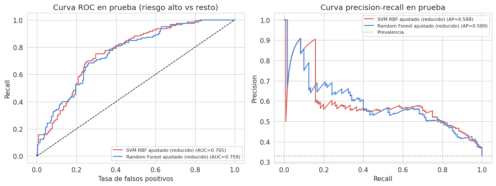
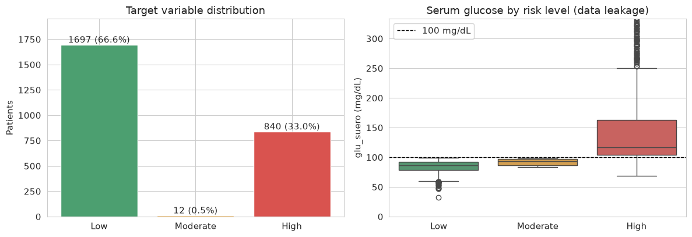
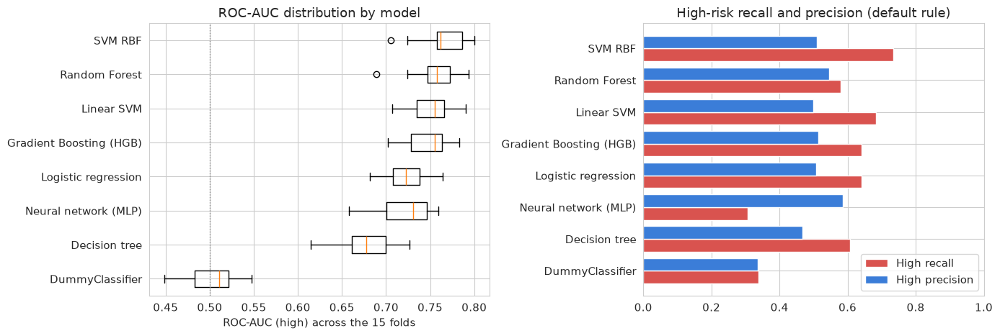
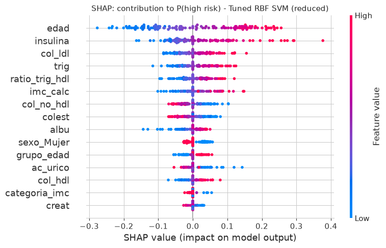
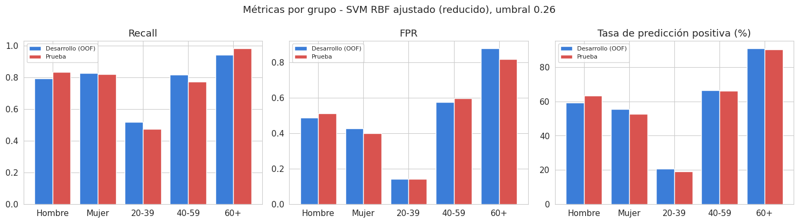

# Estimación del riesgo de diabetes en pacientes mexicanos

**Modelo de machine learning para decidir a qué pacientes conviene hacerles primero una prueba confirmatoria de diabetes, sin usar glucosa ni HbA1c.**


## El problema

En México, las pruebas que confirman la diabetes (glucosa en ayuno o HbA1c) son un recurso limitado en muchos programas de salud. Este proyecto construye un modelo que **ordena a los pacientes adultos por su probabilidad de tener riesgo alto**, usando datos que muchas veces ya están disponibles: edad, sexo, peso, estatura y un perfil bioquímico (lípidos, insulina, ácido úrico, creatinina, albúmina).

El modelo **no diagnostica**: sirve para priorizar a quién atender primero, siempre con revisión de personal de salud.

## Resultados

Modelo final: **SVM con kernel RBF** (C = 3, gamma = 0.03), con 15 variables y un umbral de decisión de **0.26** elegido para detectar al menos 80% de los casos de riesgo alto.

Evaluación en un conjunto de prueba de **365 pacientes de hogares que el modelo nunca vio**:

| Métrica (riesgo alto vs. resto) | Valor |
| --- | --- |
| **Recall** | **0.825** (detecta 99 de 120 casos de riesgo alto) |
| ROC-AUC | 0.765 |
| Precisión | 0.481 |
| F1-score | 0.607 |
| PR-AUC | 0.588 |
| ROC-AUC en validación cruzada | 0.764 +/- 0.027 (15 pliegues) |

El modelo de referencia (`DummyClassifier`) obtiene un ROC-AUC de 0.505. La métrica de prueba cae dentro del rango de la validación cruzada, sin señales de sobreajuste.



## Cómo se construyó

### 1. Datos y fuga de información
- **2,549 adultos de 2,055 hogares**, con 24 variables de una encuesta nacional de salud tipo ENSANUT ([Diabetes Mexico Data Set, Kaggle](https://doi.org/10.34740/KAGGLE/DSV/14619160)).
- Variable objetivo `riesgo_diabetes_cat`: bajo (66.6%), moderado (0.5%) y alto (33.0%).
- Se **excluyeron la glucosa y la HbA1c**, porque son las variables con las que se construyó el objetivo: usarlas habría dado un modelo casi perfecto en papel e inútil en la práctica.
- Se detectaron y limpiaron **valores centinela** (por ejemplo, peso = 222.22) que generaban IMC ficticios.



### 2. Validación sin trampas
- Partición con `StratifiedGroupKFold` **agrupada por hogar**: los integrantes de una misma familia comparten hábitos, así que nunca quedan repartidos entre entrenamiento y prueba.
- Validación cruzada repetida (5 pliegues x 3 semillas = 15 evaluaciones).
- El conjunto de prueba se usó **una sola vez**, al final, para evaluar a los finalistas.

### 3. Ingeniería de características
Cuatro variables nuevas con sentido clínico y sin fuga: relación triglicéridos/HDL (indicador de resistencia a la insulina), colesterol no-HDL, grupo de edad y categoría de IMC.

### 4. Comparación de modelos
Se compararon 8 modelos dentro del mismo pipeline de scikit-learn, con 19 experimentos registrados:

| Modelo | ROC-AUC (riesgo alto, VC) |
| --- | --- |
| **SVM RBF** | **0.764** |
| Random Forest | 0.756 |
| SVM lineal | 0.752 |
| Gradient Boosting | 0.746 |
| Regresión logística | 0.723 |
| Red neuronal (MLP) | 0.720 |
| Árbol de decisión | 0.674 |
| DummyClassifier | 0.505 |

Los hiperparámetros se ajustaron con `GridSearchCV` (SVM) y `RandomizedSearchCV` (Random Forest). El modelo final se eligió con una **matriz de decisión ponderada** (recall, precisión, ROC-AUC, estabilidad, interpretabilidad y costo operativo), no solo por la métrica más alta.



### 5. Umbral de decisión
En salud, no detectar a un paciente de riesgo alto cuesta más que una prueba extra. Por eso el umbral se optimizó con un criterio explícito: **recall mínimo de 0.80**, usando predicciones fuera de pliegue (sin tocar el conjunto de prueba).

### 6. Interpretabilidad
Importancia por permutación y SHAP. Las variables más influyentes son **edad, insulina y triglicéridos**, en línea con los factores de riesgo metabólico conocidos.



### 7. Sesgos y uso responsable
- Desempeño parejo por sexo: recall de 0.83 en hombres y 0.82 en mujeres.
- **Limitación importante:** en adultos de 20 a 39 años el recall baja a 0.47, porque el riesgo alto es menos frecuente y sus marcadores son menos claros. Está documentado en la ficha del modelo.
- La clase "moderado" tiene solo 12 casos y el modelo no la detecta.



### 8. Listo para operar
- Pipeline completo serializado con `joblib`, con huella SHA-256 para verificar su integridad.
- Script de inferencia independiente con **validación de entradas** (campos faltantes, tipos incorrectos, categorías desconocidas, valores fuera de rango).
- Plan de monitoreo con **PSI** (Population Stability Index) para detectar deriva de datos, más alertas de desempeño y equidad.
- Ficha del modelo con usos permitidos, usos no recomendados, riesgos y criterios de actualización.

## Cómo ejecutarlo

1. Descarga el dataset desde [Kaggle](https://doi.org/10.34740/KAGGLE/DSV/14619160) y guarda `Diabetes_Mexico.csv` junto al notebook (o en `data/`).
2. Instala las dependencias:
   ```bash
   pip install -r requirements.txt
   ```
3. Abre y ejecuta `Proyecto_Final_Riesgo_Diabetes.ipynb` de principio a fin (funciona también en Google Colab).

Al ejecutarse, el notebook genera automáticamente:

```
scripts/     Transformadores propios y script de inferencia
artifacts/   Pipeline serializado, umbral y metadatos del modelo
results/     Registro de experimentos, métricas y figuras
docs/        Ficha del modelo
```

## Tecnologías

Python, pandas, NumPy, scikit-learn, SHAP, Matplotlib, Seaborn y Joblib.

## Autor

**Alan Adelfo Del Angel Figueroa**, estudiante de Ingeniería en Desarrollo de Software en la Universidad Tecmilenio.
Proyecto final de la materia Algoritmos de Aprendizaje Automático (2026).

- Portafolio y contacto: [github.com/AlanDelAngel](https://github.com/AlanDelAngel)

## Referencias

- Félix Jiménez, A. F. y Sánchez Lee, V. S. (2026). *Diabetes Mexico Data Set* [Dataset]. Kaggle. https://doi.org/10.34740/KAGGLE/DSV/14619160
- American Diabetes Association. (2023). Classification and diagnosis of diabetes: Standards of Care in Diabetes 2023. *Diabetes Care, 46*(Supplement 1), S19-S40. https://doi.org/10.2337/dc23-S002
- Breiman, L. (2001). Random forests. *Machine Learning, 45*(1), 5-32. https://doi.org/10.1023/A:1010933404324

---

### English summary

Machine learning model that prioritizes which Mexican adult patients should receive a confirmatory diabetes test first, **without using glucose or HbA1c** (the variables that define the target, excluded to prevent data leakage). Built on 2,549 patients from a national health survey, with household-grouped cross-validation, 8 models compared, and a decision threshold tuned for clinical recall. The final RBF SVM reaches **0.825 recall and 0.765 ROC-AUC** on a held-out test set of unseen households, and includes SHAP interpretability, a subgroup bias analysis, a serialized pipeline with input validation, a PSI-based monitoring plan and a model card.
